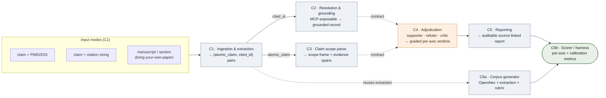

# Component Dependency Graph — Citation-Verification System

Purpose: show which components build **independently in parallel** (share only data contracts) versus which are **contract-dependent** (built against mocks, integrated on landing). This is the map the parallel Claude Code workers build against. Sharp contracts here are what make the parallel throughput real instead of drifting.

**Legend.** Solid arrow = runtime data flow. Dashed `contract` arrow = the parallelization seam: C4 is built against **mocked** C2/C3 outputs and integrated when they land. Blue = independent parallel build track. Orange = C4, the calibration-critical intellectual core. Green = the scorer, where everything converges and correctness is proven.

## How to read it for parallel execution

- **Independent tracks (fan out to separate workers, share only data contracts):** C1, C2, C3, C5, and C6a. C2 is nearly a port (re-implemented from the preserved spec) and is the smallest. C6a (corpus generator) is a **long-running track that starts on day one** — it needs only the extraction pipeline, not the rest of the system.
- **Contract-dependent (mock-first):** C4 depends on the *contracts* of C2 and C3, not their internals, so it is built against frozen mock inputs in parallel and wired in on integration. C5 depends on C4's output contract.
- **Convergence:** C6b (scorer) is the single convergence point. The whole system is organized around it — the harness is the spine, the pipeline is the thing being measured.

## Contract stubs (seed for the full contract specs)

| Comp | Input (contract in) | Output (contract out) | Build track | Notes |
|---|---|---|---|---|
| **C1** Ingestion/extraction | claim+PMID/DOI · claim+citation string · manuscript | list of `(atomic_claim, cited_identifier)`, verbatim-guarded | A (parallel) | splits compound claims; houses BYO-paper mode |
| **C2** Resolution/grounding | `cited_identifier` | grounded record (`grounded.json`): MeSH organism/pop tags keyed on tree #, retraction status, abstract, pub metadata | B (parallel; re-impl from spec) | metadata-grounded; MCP-exposable; parquet + NCBI efetch |
| **C3** Claim scope parse | `atomic_claim` | scope frame (organism, population, effect, direction, dose) + evidence spans; provenance = model-inferred | C (parallel) | claim-side language work only |
| **C4** Adjudication | grounded record + scope frame | per-axis **graded** verdicts + confidence + provenance (`verdict.json`++) | D (mock-first) | adversarial S/R/C; metadata axes stay objective; **calibration make-or-break** |
| **C5** Reporting | adjudication output | auditable source-linked report; grounded-vs-inferred legible at a glance | A (parallel) | human-facing |
| **C6a** Corpus generator | cited-source seeds + extraction pipeline | two-tier corpus (objective axes large & cheap / graded axis agent-labeled) | E (long-running, day 1) | fixes the known eval-set defects |
| **C6b** Scorer/harness | full pipeline + corpus | per-class & per-axis metrics; specificity on hard controls; **calibration** on graded axis | convergence | the proof of correctness |

## Thin vertical slice (built first, before any depth)

`claim + one PMID` → **C1** (core mode) → **C2** (real grounding: efetch + parquet retraction lookup + MeSH tree split) → **C4-STUB** (returns a correctly-shaped verdict, no adversarial reasoning yet) → **C5** (minimal report). Runnable end-to-end. Its only job is to surface integration/contract problems on day one and give every later component a working spine to attach to.

## Two flags carried on the graph

1. **C2 code is a re-implementation, not a port.** The original grounding/extraction code was not persisted — only its outputs and a precise field-level spec. NCBI E-utilities reachability and exact field parsing were verified live, so this is well-defined.
2. **C4 grades its own homework.** The adjudication agent produces both the graded verdict *and* the corpus label it is scored against (§8). Calibration is therefore a first-class requirement with its own research and its own metric on C6b — not a closing nicety.
