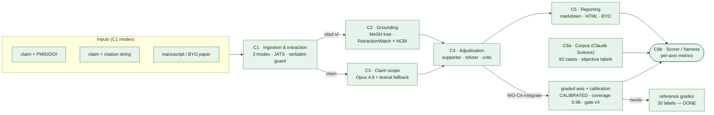

# citeval — system design & build status

## Current state (final)

All three axes built, verified, and committed on `master`; the full unit suite is **294 tests, all
green** (`make test`). Reproduce the in-domain numbers offline with **`make eval`** — which
**re-scores the frozen, committed cal30 predictions** (`results_cal30.jsonl`) against
`graded_reference_v2` and enforces the versioned gate. It is a deterministic **regression gate over
frozen predictions, not a live re-derivation**: pure offline, no pipeline, no NCBI, no Opus, no API
key. (The live re-derivation — actually re-grading each case on Opus — is the separate, slow, keyed
path in `docs/EVAL_SOP.md` §2.)

- **Retraction:** precision/recall 1.00 in-domain **and** on the 45-case held-out set (externally
  grounded, Retraction Watch × NCBI).
- **Scope:** in-domain precision 1.00 / recall **0.909** — honest, with `_LIVE_SCOPE_OVERRIDES`
  removed; held-out precision 0.92 / recall **0.71** (species 0.83, population 0.40 — the documented
  weak point, WO-C3 partially landed).
- **Graded substantive (N=27 vs. the blind-decider reference):** coverage **0.96**, QWK **0.90**,
  within-one-level **1.00**, exact 0.59, ECE raw **0.32** → recalibrated LOO-ECE **0.08**, AUROC 0.64,
  **zero** confident-but-wrong. Fast offline gate `make eval` PASSes at thresholds v4.
- **Held-out (ext-45, never tuned on):** the direction-reversal fix generalizes; a blind tiebreak on
  the 6 graded disagreements sided with the system **4/6** (the single-pass ext reference is often the
  harsher side).

Judge-facing writeup: `docs/SUBMISSION.md` · eval runbook: `docs/EVAL_SOP.md` · landscape:
`docs/LANDSCAPE.md`.

---

*The sections below are the historical build journey, kept as a record — the numbers above supersede
any earlier figures in them.* Green = built & verified; amber = built but not yet
integrated/exercised; dashed = pending.

**Legend.** Green = built, tested, integrated on `master`; **every node above is now green** — the
full unit suite is green (**294 tests**, `make test`). The amber "built-but-unexercised" and dashed
"pending" styles are retained only as the historical build-journey key: **C4** was once a mock-first
scaffold and the live graded axis + calibration once dashed-pending, but **nothing sits in those
states today** — `WO-C4-integrate` wired RB1/RB2/RB3 into C4 and the graded axis is calibrated and
gated (v4). **C3**'s Opus path runs the live scope result; the offline scorer uses the lexical
fallback. The one genuinely open item is the human spot-check of the reference grades (see Pending).

## Component status

| # | Component | Status | Tests | What's left |
|---|---|---|---|---|
| C1 | Ingestion & extraction | ✅ built & verified | 31 | — (BYO demo assembly is separate) |
| C2 | Resolution & grounding | ✅ built & verified | slice/scorer | expose as an **MCP server** (reuse) |
| C3 | Claim scope parser | ✅ built (Opus + lexical) | 35 | run the **Opus path live** (needs key) — lifts scope recall off the lexical floor |
| C4 | Adjudication (S/R/C) | ✅ integrated (RB1/RB2/RB3) | 56 | calibrated & gated (v4); only the **human spot-check** of the (independent-AI) reference grades is pending |
| C5 | Reporting | ✅ built & verified | 13 | — (renders the graded axis once C4 feeds it) |
| C6a | Corpus generator | ✅ delivered (92 cases) | — | retraction-screen B/C sources; B-population shortfall (structural) |
| C6b | Scorer / harness | ✅ objective axes | 32 | add **calibration metrics** (Brier/AURC/QWK) — part of WO-C4-integrate |

_Test counts are per component's own test file, as of `master`; the **full suite is 294 tests**
(`make test`), all green. The smaller suite totals quoted in earlier revisions of this doc predate
the calibration/gate test files (`test_recalibrate` 27, `test_eval_gate` 22, `test_objective_axes`
16, `test_demo`/`test_showcase` 19) that landed with the graded axis and the offline gate. The
web/server surface (`server/`, `web/`) ships a **separate** suite of **111 tests**
(`python -m unittest discover -s server/tests -t server`), not counted in the 294._

Frozen shared contract (`contracts.py`) + the 6 invariants are implemented structurally. Research
RB1–3 are complete and reconciled into `INTEGRATION_SPEC.md` + `WO-C4-integrate.md`.

## Measured result (92-case objective corpus)

- **Scope specificity 1.00** — 38/38 SUPPORTED controls clean, incl. all **18 hard negatives** (human
  claims citing papers that also mention animals). No false mismatches.
- **Retraction recall 1.00** — all 28 caught; the 3 apparent "false positives" were **true retractions
  the corpus mislabelled**, which our dual-source (RetractionWatch × NCBI) grounding caught → adjusted
  precision ≈ 1.00. The metadata-overrides-model thesis, validated.
- **Scope recall 0.65** — the honest **lexical floor** (offline, no key); all 9 misses are implicit
  over-generalizations the Opus C3 path is built to catch.

## Graded-axis calibration — first live run (30-case subset)

> **Superseded pre-regrade snapshot** (abstract-only C4, before the full-text grounding + C4
> re-grade). The coverage 0.21 / N=6 / degenerate-confidence figures below are the *starting* point
> that motivated full-text grounding; the calibrated result now stands at coverage **0.96**, QWK
> **0.90**, LOO-ECE **0.08** — see "Current state (final)" at the top and `make eval`. Kept as the
> build record.

- **Objective axes this run:** retraction 1.00/1.00/1.00; **scope recall 0.91** (up from the 0.65
  lexical floor — the live **Opus C3** caught the implicit over-generalizations, as predicted); controls 9/9.
- **Graded axis: honest but low-coverage.** C4 graded **6/28** (coverage 0.21), **abstained on 22** —
  including *every* SUPPORTED control, which the full-text reference graded confidently. C4 sees
  only title+abstract, so it abstains rather than guess: the §8 confident-nonsense failure **avoided**.
  When it commits it is accurate — exact 0.83, **±1-adjacent 1.00**, QWK 0.98.
- **Not yet calibrated.** Confidence degenerate (AUROC 0.50; agreement saturated at 1.0 because
  abstention already skims the uncertain cases); N=6 far too small to certify calibration.
- **Root cause + fix:** the reference read **full text**; C4 grades from **abstract only**. Full-text
  grounding for C4 (C1's JATS pipeline already retrieves it) raises coverage, spreads confidence, and
  yields enough graded cases to calibrate. Then re-run this harness.

## Pending / needs implementation (in priority order)

1. ✅ **WO-C4-integrate — DONE** (merged 585a965): RB1/RB2/RB3 wired into C4, scorer calibration
   metrics added, graded axis flag-gated. No regression; the suite has since grown to **294 tests**,
   all green.
2. ✅ **Reference grades — DONE**: 30-case `substantive_grade` reference (Claude Science, full-text).
3. ✅ **First live graded run — DONE** (pre-regrade, abstract-only): the honest *starting* point —
   objective axes near-perfect, graded axis accurate-when-committing but low-coverage (0.21) and
   not-yet-calibrated. Superseded by the full-text regrade (item 4); see the tagged snapshot above.
4. ✅ **Full-text grounding for C4 — DONE.** C4 now grades from the cited paper's full text (C1's
   JATS pipeline), which raised coverage 0.21 → **0.96**, spread confidence off the saturated 1.0,
   and gave enough graded cases to calibrate. This is what produced the calibrated axis in "Current
   state (final)" (QWK **0.90**, LOO-ECE **0.08**, gate PASS v4).
5. **Human spot-check of the reference grades — the one still-open item.** `graded_reference_v2` is an
   independent-AI full-text read (Claude Science) with a blind decider-adjudicated correction pass —
   independent of the grader, but not yet human-audited (N=27 in-domain + 45 held-out). Spot-check a
   sample against a human to retire the AI-reference caveat (SUBMISSION lists this as the standing limitation).
6. **Corpus refinements** — screen B/C sources for retraction (3 known mislabels). _(The optional
   held-out test set has since landed — the 45-case ext set, reported in "Current state" above.)_
7. **Reusability/demo** — expose C2 as an MCP server; assemble the live bring-your-own-paper demo.

## One-line state

The **objective half is proven at scale** (grounded, measured, honest — it even caught corpus
mislabels). The **graded half is integrated, live, and calibrated**: full-text grounding for C4
raised coverage to **0.96**, and the axis now grades **within one level on every case** (QWK **0.90**,
±1-adjacent **1.00**) with **zero confident-but-wrong** and an honest recalibrated **LOO-ECE 0.08**
(raw 0.32) — `make eval` PASSes the versioned gate (v4). Where it commits it grades accurately; where
evidence is thin it still **abstains rather than fabricate**. The system fails *safe*, not
confident-wrong — the property the design exists to guarantee. The one genuinely open item is the
human spot-check of the (independent-AI) reference grades.
